# MP-Commander User Manual

**Multi-Pane Commander 1.8** — a Double Commander–style file manager with 2, 3, 4, 6 or 8 panes

[한국어 설명서](MANUAL.md)

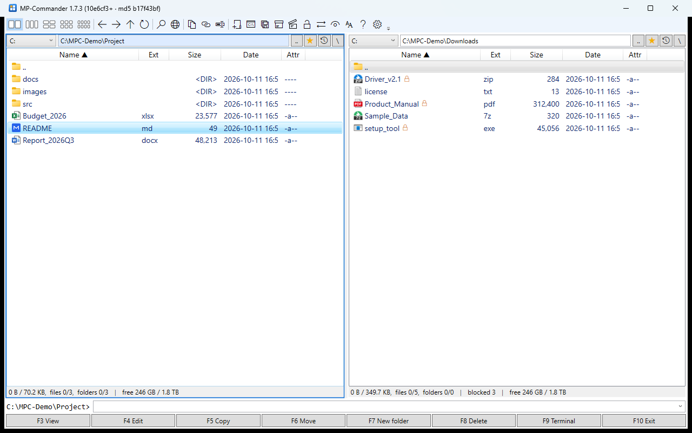

---

## Contents

- [Getting started](#getting-started)
- **Part 1 — Features**
  1. [Screen layout](#1-screen-layout)
  2. [Pane layouts, active and target pane](#2-pane-layouts-active-and-target-pane)
  3. [Moving between folders](#3-moving-between-folders)
  4. [Selecting files](#4-selecting-files)
  5. [File operations — copy, move, delete, rename](#5-file-operations--copy-move-delete-rename)
  6. [Viewer (F3) and finding text in a file](#6-viewer-f3-and-finding-text-in-a-file)
  7. [Find files (Alt+F7)](#7-find-files-altf7)
  8. [Compress and extract](#8-compress-and-extract)
  9. [Unblock (files downloaded from the internet)](#9-unblock-files-downloaded-from-the-internet)
  10. [Backup-Copy](#10-backup-copy)
  11. [Remote connections — FTP / FTPS / WebDAV](#11-remote-connections--ftp--ftps--webdav)
  12. [Android phones (USB)](#12-android-phones-usb)
  13. [Command line and terminal](#13-command-line-and-terminal)
  14. [Right-click menu](#14-right-click-menu)
  15. [Folder history and the favorite star](#15-folder-history-and-the-favorite-star)
  16. [Auto-refresh and freeze protection](#16-auto-refresh-and-freeze-protection)
  17. [Settings](#17-settings)
  18. [Keyboard shortcuts](#18-keyboard-shortcuts)
- **Part 2 — Tasks**
  - [A. Deploying a program update safely (backup and rollback)](#a-deploying-a-program-update-safely-backup-and-rollback)
  - [B. Finding and analyzing errors in logs](#b-finding-and-analyzing-errors-in-logs)
  - [C. Tidying up downloaded programs and files](#c-tidying-up-downloaded-programs-and-files)
  - [D. Compressing files to send or archive](#d-compressing-files-to-send-or-archive)
  - [E. Backing up phone photos and videos](#e-backing-up-phone-photos-and-videos)
  - [F. Managing files on a NAS or web server](#f-managing-files-on-a-nas-or-web-server)
  - [G. Organizing many folders on one screen](#g-organizing-many-folders-on-one-screen)
  - [H. Working on slow network shares](#h-working-on-slow-network-shares)
- [Troubleshooting (FAQ)](#troubleshooting-faq)

---

## Getting started

### Installation

There is no installer. Unzip the release package (`MP-Commander-1.8.x-win-x64.zip`) anywhere and run `MP-Commander.exe`.
Three files are all it needs (about 0.4 MB):

| File | Purpose |
|---|---|
| `MP-Commander.exe` | The program |
| `MP-Commander.exe.config` | .NET runtime settings |
| `FmCore.dll` | Native (C++) module for fast file work |

The package also contains `lang\` (language packs) and `manual\` (this manual).

**Requirements:** 64-bit Windows 10 version 1803 or later (including LTSC 2019) or Windows 11. .NET Framework 4.7.2 is built in, so nothing else needs to be installed.

**7z format:** install [7-Zip](https://www.7-zip.org/) or put `7za.exe` in the MP-Commander folder. ZIP works without it.

### Start folders

```
MP-Commander.exe "C:\Work" "\\nas\share" ftp://webserver
```

Opens the given paths in panes 1, 2, 3 ... Put this in a shortcut to always start in the same folders.

### Opening this manual

Press **F1** or the **?** button at the right end of the toolbar. It opens the manual for the display language
(`manual\MANUAL.en.md` in English) — with `MDNotePad+.exe` if it is in the same folder, otherwise with the program associated with `.md`
(or the Windows "Open with" dialog if there is none).

### Display language (English / 한국어)

At first MP-Commander follows the **Windows display language** (Korean Windows → Korean, anything else → English).
Change it in Settings (gear button) → **언어 / Language**; it is applied after a restart.
Language packs are plain text files such as `lang\en.txt` in the program folder, so you can adjust wording or add another language
(copy `en.txt` to `xx.txt` and translate the `=> ` lines).

### Where settings are stored

`%APPDATA%\MP-Commander\` — window position, pane folders and options (`settings.ini`), folder history (`MP-Commander.ini`),
remote connections (`connections.ini`, passwords encrypted).
Nothing is written to the program folder, so updating means replacing the program files.

---

# Part 1 — Features

## 1. Screen layout


| Where | What |
|---|---|
| Top | **Toolbar** (hover over an icon for its description and shortcut) |
| Pane header | Drive list · path box · `..` (parent) · ☆ (favorite) · 🕘 (history) · `\` (root) |
| Pane list | Name · Ext · Size · Date · Attr. Click a header to sort |
| Below each pane | Selected size/count · **blocked n** (files downloaded from the internet) · free space |
| Bottom | **Command line** (runs commands in the active pane's folder) |
| Very bottom | F3–F10 function buttons |

### Toolbar


| Icon (left to right) | Function | Shortcut |
|---|---|---|
| Five grids | 2 panes / 3 / 4 (2×2) / 6 (2×3) / 8 (2×4) | Ctrl+F2 / F3 / F4 / F6 / F8 |
| ← → ↑ ⟳ | Back / forward / parent folder / refresh | Alt+← / Alt+→ / Backspace / Ctrl+R |
| Magnifier | Find files | Alt+F7 |
| Globe | Remote connections (FTP / WebDAV) | Ctrl+F |
| Document · chain · text | Copy current folder path / full paths of selection / names | — / Ctrl+Shift+C / — |
| Folder+ · `C:\` | New folder / terminal here | F7 / F9 |
| Folder + clock | **Backup-Copy** | Ctrl+B |
| Box · open box | **Compress** / **Extract** | Alt+F5 / Alt+F9 |
| Lock | **Unblock** | Ctrl+Shift+U |
| ⇄ | Swap active and target pane paths | Ctrl+U |
| Eye | Show hidden files | Ctrl+H |
| AA | List font size (small · normal · large) | Ctrl+= / Ctrl+- |
| Document + sync | **MDNotePad+ sync mode** — opens the .md file under the cursor in the full mode with repository, sync and git (shown only when MDNotePad+.exe is in the same folder) | — |
| ? | **User manual** (this document) | F1 |
| Gear | **Settings** | — |

---

## 2. Pane layouts, active and target pane

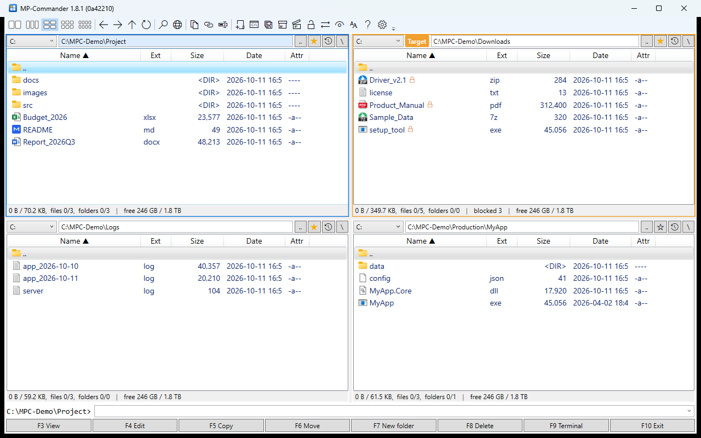

- **Layouts:** 2 and 3 panes side by side, 4 as 2×2, 6 as 2×3, 8 as 2×4. Panes are numbered 1, 2, 3 ... from the top-left.
- **Active pane** (blue border): the pane you are working in. All keyboard commands apply to it.
- **Target pane** (orange border and `Target` label): the **default destination** of copy (F5), move (F6), compress, extract and Backup-Copy.
  - The target is the previously active pane. With 2 panes it is always the other one.
  - **Ctrl+Shift+number** pins the target (e.g. always send to pane 4 in a 4-pane layout).
- Switch panes: **Tab / Shift+Tab** next/previous, **Ctrl+1–8** a specific pane.
- **Ctrl+← / Ctrl+→**: open the folder under the cursor in the pane to the left/right.
- **Ctrl+U**: swap the active and target pane paths.

The layout, folders, sorting and window size are saved on exit and restored next time.

---

## 3. Moving between folders

| Action | How |
|---|---|
| Open a folder / run a file | **Enter** or double-click |
| Parent folder | **Backspace**, the `..` item, the `..` button next to the path, Ctrl+PgUp |
| Root | **Ctrl+\\**, the `\` button next to the path (top of a drive, share, FTP/WebDAV connection or phone) |
| Type a path | Path box (Ctrl+L), then Enter. Environment variables like `%TEMP%` work |
| Drive | Drive list at the top-left of a pane, **Alt+F1 / Alt+F2** |
| Back / forward | **Alt+← / Alt+→**, the mouse back/forward buttons (active pane only) |
| Quick search | Type in the list to jump to the item starting with those letters (keep typing within 1.5 s) |

> **Backspace** always goes to the active pane's parent folder, wherever the focus is. While you are typing a quick search it deletes the last character.

---

## 4. Selecting files

Selected items are shown in **red**. With no selection, commands apply to the item under the cursor.

| Action | How |
|---|---|
| Select/deselect one by one | **Insert**, **Space**, **Ctrl+click** |
| Select a range | **Shift+↑↓**, **Shift+click** |
| Select / deselect by mask | **Num+** / **Num-** (e.g. `*.log`) |
| Invert / all | **Num*** / **Ctrl+A** |

> **Ctrl+click** works like Double Commander: when nothing is selected yet, Ctrl+clicking another item also selects the item under the cursor.

---

## 5. File operations — copy, move, delete, rename

| Operation | Key | Notes |
|---|---|---|
| Copy | **F5** | To the target pane folder by default. With a single item you can also type a new name |
| Move | **F6** | Same as copy |
| Rename | **Shift+F6**, **F2** | |
| New folder | **F7** | |
| Delete | **F8**, **Del** (Recycle Bin) / **Shift+F8**, **Shift+Del** (permanent) | Phones, FTP and WebDAV have no Recycle Bin — deletion is permanent |
| Clipboard | **Ctrl+C / Ctrl+X / Ctrl+V** | Works both ways with File Explorer. Pasting into the same folder creates `name - Copy` |
| Drag and drop | Drop on another pane (or a folder in it) | Copy/move menu. Hold Ctrl to copy at once, Shift to move at once |

- If a file with the same name exists you are asked: **Overwrite / Overwrite all / Overwrite older only / Skip / Skip all / Cancel**.
- The progress window shows per-file and total progress and speed. Short operations finish without it.
- If progress stops for more than 5 s (slow network etc.) a warning appears, and [Cancel] also breaks blocked I/O.
  (Time spent waiting for your answer in a prompt does not count as a stall.)

---

## 6. Viewer (F3) and finding text in a file

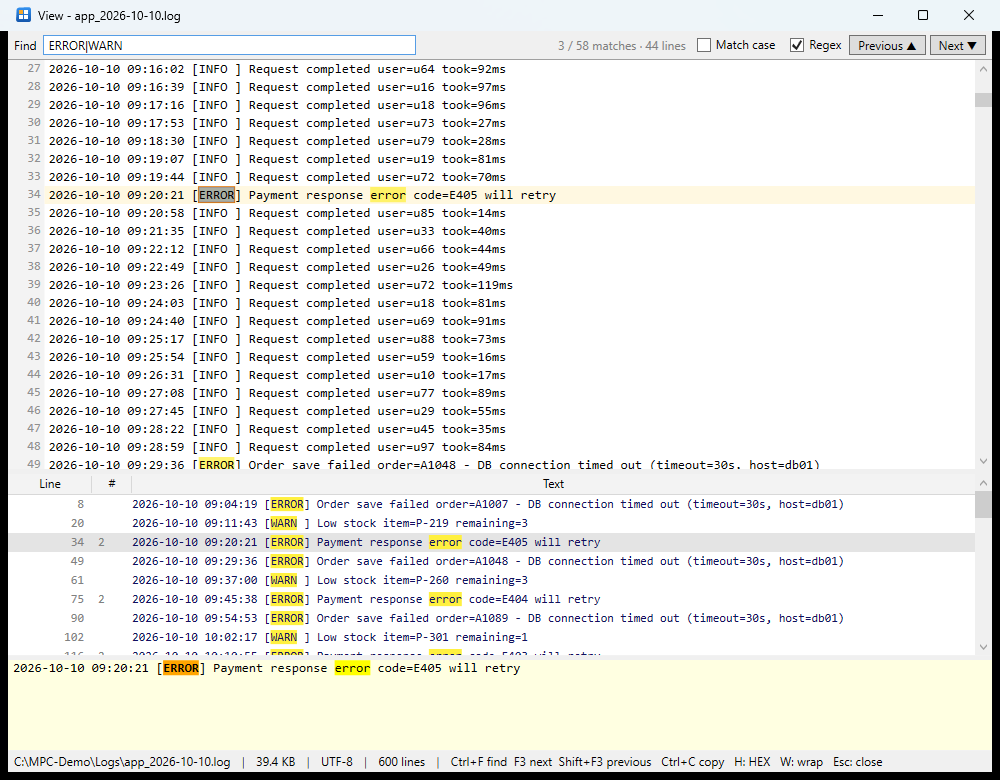

**F3** (or the `F3 View` button) opens the file under the cursor.

> **Markdown (.md)** files open in MDNotePad+ when `MDNotePad+.exe` is in the same folder (otherwise in this viewer).

- **Text:** encoding detected automatically (UTF-8 / UTF-16 / Korean ANSI). Line numbers on the left.
- **Any file size opens at once** (a 300 MB log in about 0.2 s). Only the visible lines are read and drawn; the line index is built in the background
  (`indexing n%` in the status bar, then the total line count). The scroll bar reaches **the whole file**, beginning to end (Ctrl+Home / Ctrl+End).
- **Character selection and copy:** drag or Shift+click, then **Ctrl+C**. Double-click selects a word (and shows the whole line below); **Ctrl+A** selects everything.
  Multi-line and large ranges are read in the background (up to 64 MB).
- **HEX:** **H** switches text ↔ HEX (first 512 KB). Binary files open as HEX automatically.
- **Images:** jpg, png, bmp, gif, tif, ico, webp.
- **W:** toggle word wrap. **Esc** (or F3 when there is nothing to find) closes the viewer.

### Finding text in the file

1. Type in the **find box** (Ctrl+F) and **pause for 0.5 s** — the **whole file** is searched (Enter / F3 search at once). About 1 s for 300 MB, a few seconds with a regex.
   While it searches you can keep reading and scrolling (once you scroll, the search no longer moves the view); matching lines keep being appended to the list — without flicker, and the list keeps its selection and scroll position.
2. **F3** next, **Shift+F3** previous (Enter and the `Next ▼` / `Previous ▲` buttons do the same).
3. The current match is marked with an **orange box** in the text, and the view scrolls to it.
4. The top right shows **current position / matches · lines**, e.g. `3 / 44 matches · 44 lines` (for the whole file).
5. The pane below lists **every matching line** with its line number and count, matches in yellow. Picking a line moves the text there.
6. Under it the **whole selected line** is shown word-wrapped (even a very long log line is fully visible).
7. Drag the boundaries between the panes to resize them.

Options:

- **Match case**
- **Regex** — .NET regular expressions. `^` and `$` match per line (also with Windows `\r\n` line endings). An invalid pattern shows an error.

> The viewer **closes the file right after reading**. While it is open, other programs can keep writing to the file, rename it or delete it (a program can keep writing its log while you read it).

---

## 7. Find files (Alt+F7)

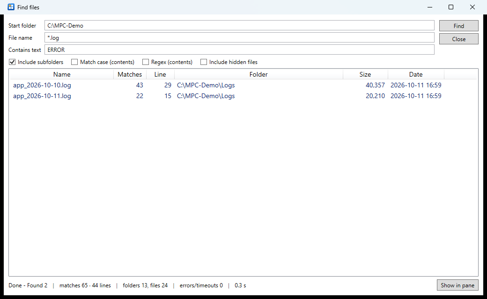

| Field | Meaning |
|---|---|
| Start folder | The active pane folder by default |
| File name | Several masks separated by `;` such as `*.txt;*.log`. Without wildcards, names containing the text are found |
| Contains text | Text to find in file contents (UTF-8 / Korean ANSI / UTF-16 files) |
| Include subfolders / Match case / **Regex** / Include hidden files | Options |

- Searches on several threads; on a slow network a read that takes more than 5 s is skipped and the search continues.
- With "contains text", the results get **Matches** (how many times) and **Line** (how many lines) columns, with totals in the status bar.
  - Counted in the background: `…` while counting, `-` for files over 64 MB or files that could not be read.
- **Enter / double-click** a result: opens its folder in the pane with the cursor on the file.
- **F3** on a result: opens it in the viewer **already searching the "contains text"** (with the same case and regex settings). Press F3 to go to the next match right away.
- **Esc:** stops a running search, otherwise closes the window.

> **Ctrl+Alt+F7 — Everything**: if [Everything](https://www.voidtools.com/) (voidtools) is installed, opens an Everything search window **limited to the current folder**.
> Handy for finding names across whole drives in an instant. Everything is looked for in the program folder (portable), the running Everything, the install information and Program Files.

---

## 8. Compress and extract

### Compress (Alt+F5, box button)

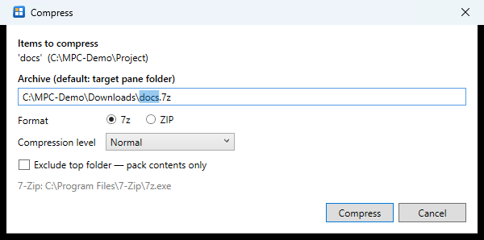

1. Select the files/folders to compress (or use the item under the cursor).
2. The archive is created in the **target pane folder** by default. You can change the path and name.
3. **Format:** **7z** (default, needs 7-Zip) or **ZIP** (built in; names stay readable everywhere).
4. **Compression level:** store (no compression) / fast / normal / maximum.
5. With a single folder selected you can turn on **Exclude top folder — pack contents only**: extracting gives the contents directly, without the folder.

Format, level and options are remembered. Cancelling never leaves a half-written archive.

### Extract (Alt+F9, open-box button)

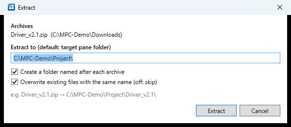

1. Select archives — **several at once** are fine.
2. The destination is the **target pane folder** by default.
3. **Create a folder named after each archive** (on by default): `Driver_v2.1.zip` → `Driver_v2.1\`. An example is shown below.
4. **Overwrite existing files with the same name** (on by default; off = skip).

Formats: ZIP (built in), 7z · RAR · TAR · GZ · BZ2 · XZ · CAB · ISO · WIM and more (7-Zip). `.tar.gz` · `.tgz` · `.tar.xz` are extracted all the way in one go.

---

## 9. Unblock (files downloaded from the internet)

Windows marks files downloaded from the internet as "came from another computer". With this mark, programs show a security warning on launch, documents open in Protected View, and DLLs or scripts are blocked.

- Such files show an **orange lock** next to the name, and the pane footer shows the count, e.g. `blocked 3` (right pane of the [main window](#1-screen-layout)).
- **Ctrl+Shift+U** or the lock button removes the mark.

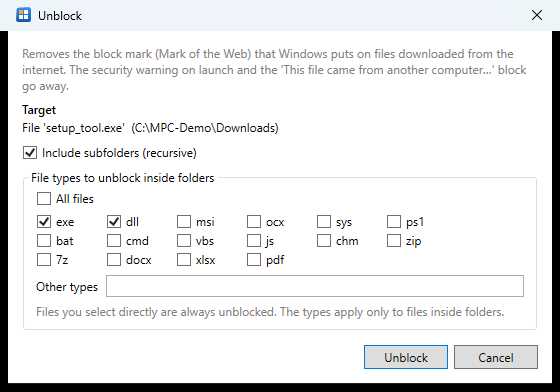

| Option | Meaning |
|---|---|
| Target | The selected files/folders, else the item under the cursor, else the current folder |
| Include subfolders | On by default |
| File types | Types to unblock inside folders (default exe, dll). **All files** is also possible |

Files you select directly are always unblocked. Read-only files are handled too and keep their attribute. This is the same as "Unblock" in the File Explorer properties or PowerShell `Unblock-File`.

---

## 10. Backup-Copy

For **replacing files in a target folder with new versions after backing up the old ones** — typically a program update.
Toolbar folder-and-clock button, **Ctrl+B**, or `Backup-Copy` in the right-click menu.

### ① Preparation window

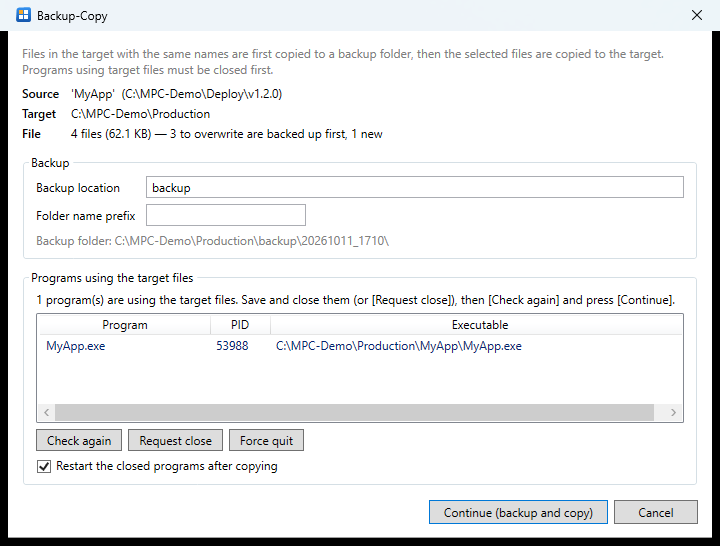

- **Source / Target / Files:** how many files will be copied, how many **overwrite** existing files (backed up first) and how many are **new**.
- **Backup location:** `backup` by default (a relative path goes under the target folder). Absolute paths such as `D:\Backups\MyApp` also work.
- **Folder name prefix:** optional. E.g. `v1.1.3_` → `backup\v1.1.3_20261011_1022\`. The backup folder path is previewed.
- **Programs using the target files:** programs running or using the files to be overwritten (running exe, loaded DLLs, open files).
  - **Request close:** asks the program to close its window (answer any save prompt in that program).
  - **Force quit:** unsaved work is lost; you are asked to confirm.
  - **Check again:** check again after closing a program yourself.
- **Restart the closed programs after copying** (on by default): starts them again with the same executable and arguments.

### ② Backup → copy

Press [Continue]; a progress window appears and

1. the files to be overwritten are first copied to the backup folder **with the same folder structure** (a file that cannot be backed up is not overwritten);
2. the new files are copied to the target.

If a file is still being used by another program, this window appears:

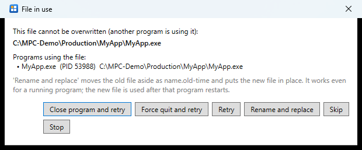

| Button | Action |
|---|---|
| Close program and retry | Asks the program to close, then copies again |
| Force quit and retry | Ends the program, then copies again |
| Retry | Copies again after you closed it yourself |
| **Rename and replace** | Moves the old file aside as `name.old-time` and puts the new file in place. **Works for a running exe or dll** — the new file is used after that program restarts |
| Skip / Stop | Skip this file / stop the operation |

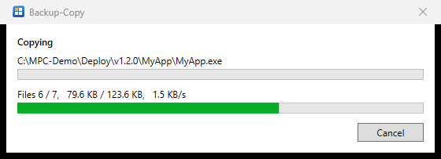

### ③ Afterwards

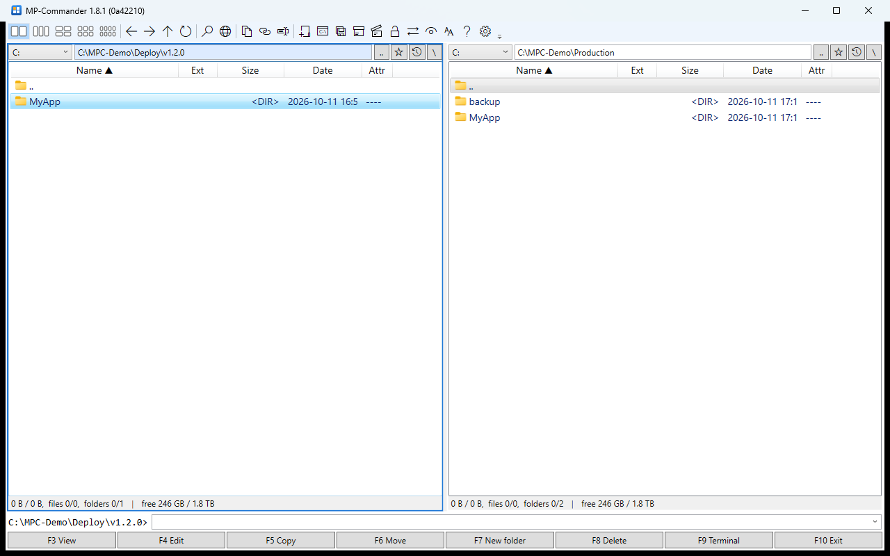

- `backup\20261011_1022\` appears in the target folder (or your chosen location) with the old files and a **`backup-copy.log`** (what was backed up, copied and closed, and any failures).
- The closed programs are restarted and the status bar shows `copied n, backed up m, restarted k │ backup: path`.

> To roll back, see Part 2 [A. Deploying a program update safely](#a-deploying-a-program-update-safely-backup-and-rollback).

---

## 11. Remote connections — FTP / FTPS / WebDAV

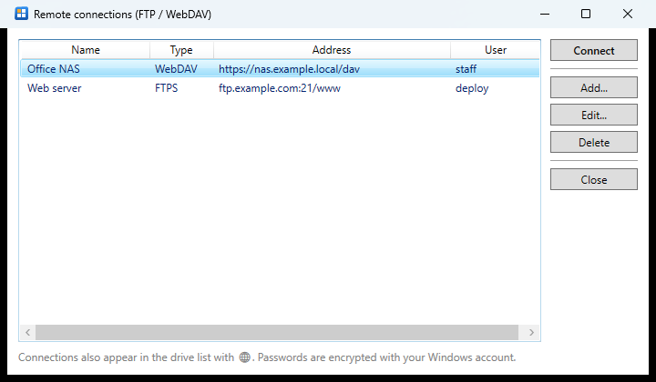

Manage connections with **Ctrl+F** or the globe button (add / edit / delete / connect).

- Types: **FTP**, **FTPS** (explicit TLS), **WebDAV** (http/https). SFTP (SSH) is not supported.
- Saved connections also appear in the drive list with 🌐. Paths look like `ftp://name/folder` and `dav://name/folder`.
- Listing, copy and move (F5/F6, drag and drop) — PC ↔ remote and remote ↔ remote (e.g. FTP → WebDAV), new folder, rename, delete (permanent), F3/F4/Enter (open a temporary copy).
- WebDAV shows the real free space when the server reports it.
- Passwords are **encrypted** with your Windows account (they cannot be decrypted by another account or PC).
- For a NAS with a self-signed certificate, turn on "Ignore certificate errors" in the connection settings.
- If the server does not respond, the request is dropped within 5 s and an error is shown (the program does not freeze).

---

## 12. Android phones (USB)

1. Connect the phone by USB and unlock it.
2. In the phone's USB notification choose **File transfer**.
3. Pick `📱 device name` at the end of the drive list. Paths look like `mtp://device/storage/folder`.

- Copy and move between phone and PC, new folder, rename, delete (permanent), free space.
- F3/F4/Enter download the file to a temporary folder and open it (changes made with F4 are not uploaded automatically).
- Find files, the terminal and auto-refresh are not available on a phone.

---

## 13. Command line and terminal

- **Command line** at the bottom (Ctrl+E): the prompt shows the active pane folder, and commands run in that folder.
  - Enter: programs start directly, documents open with their associated program, internal commands like `dir` or `copy` and batch files run in a cmd window.
  - Shift+Enter: always run in a cmd window and keep it open.
  - `cd path`, `cd..`, `D:` are not run; they **move the pane**.
  - ↑↓ previous commands (last 50).
  - Ctrl+Enter / Ctrl+Shift+Enter / Ctrl+P: insert the file name / full path / current folder path.
- **F9:** open a terminal in the current folder (Windows Terminal if installed, otherwise cmd).

---

## 14. Right-click menu

- Top part: MP-Commander commands — view, edit, copy/move to the target pane, **Backup-Copy**, rename, copy path/name, compress, extract, unblock.
- Bottom part: **the same shell menu as File Explorer** — 7-Zip, Bandizip, Send to, Open with, Properties, Git and other installed extensions. Hold Shift for the extended menu.
- Right-click an empty area for the folder menu (paste, new folder, refresh, copy path, terminal, unblock this folder ...).
- If a network server does not respond, the shell menu is left out (to avoid freezes caused by shell extensions).

---

## 15. Folder history and the favorite star

- **Alt+↓** or the 🕘 button next to the path: the folder history menu.
  - Top: **frequent folders** — the 5 folders ranked by time spent and visits (they sink when not visited for a while).
  - Below: recent folders (shared by all panes).
- **☆ button (Ctrl+D):** **pins** the current folder to the top of the frequent folders. It lights up as a yellow ★ when the folder is in the list; click again to remove it.

---

## 16. Auto-refresh and freeze protection

When files in a folder are added, deleted or renamed, the list updates by itself (cursor and selection are kept).

| Location | Delay |
|---|---|
| Local drives, USB | under 1 s |
| Network shares (`\\server\share`) | about 2–5 s |
| WebDAV / FTP connections, phones | up to 8 s |

So that a slow or broken network never freezes the program:

- Network paths are checked first: the server must answer within 2 s.
- If reading a folder makes no progress for 5 s, it is stopped and a yellow error bar offers [Retry] (the previous list stays).
- If a copy stalls, the progress window warns you and [Cancel] also breaks the blocked operation.

---

## 17. Settings

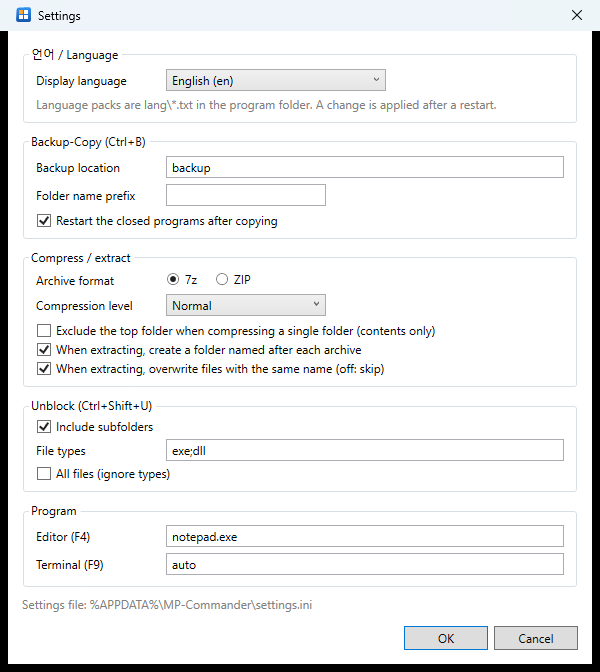

Open with the gear button on the toolbar.

| Group | Items |
|---|---|
| 언어 / Language | Display language — Automatic (Windows language), 한국어, English. Applied after a restart |
| Backup-Copy | Backup location, folder name prefix, restart afterwards |
| Compress / extract | Default format and level, exclude top folder, a folder per archive, overwrite |
| Unblock | Include subfolders, file types, all files |
| Program | F4 editor (Notepad by default), F9 terminal (`auto` = Windows Terminal first) |

Hidden files (Ctrl+H) and font size (Ctrl+= / Ctrl+-) are changed directly on the toolbar and saved.

---

## 18. Keyboard shortcuts

| Group | Key | Action |
|---|---|---|
| Files | F3 / F4 | View / edit |
| | F5 / F6 | Copy / move (to the target pane) |
| | Shift+F6, F2 | Rename |
| | F7 | New folder |
| | F8, Del / Shift+F8, Shift+Del | Delete to Recycle Bin / permanently |
| | Ctrl+C / Ctrl+X / Ctrl+V | Clipboard copy / cut / paste |
| | Ctrl+B | Backup-Copy |
| | Alt+F5 / Alt+F9 | Compress / extract |
| | Ctrl+Shift+U | Unblock |
| | Alt+F7 | Find files |
| | Ctrl+Alt+F7 | Everything search window (current folder) |
| Navigation | Enter / Backspace | Open / parent folder |
| | Ctrl+\\ | Root |
| | Alt+← / Alt+→ | Back / forward |
| | Alt+↓ | Folder history |
| | Ctrl+D | Favorite star |
| | Alt+F1 / Alt+F2 | Drive list |
| | Ctrl+L | Path box |
| Panes | Tab / Shift+Tab | Next / previous pane |
| | Ctrl+1–8 / Ctrl+Shift+1–8 | Go to pane / pin as target pane |
| | Ctrl+← / Ctrl+→ | Open the folder under the cursor in the side pane |
| | Ctrl+U | Swap active and target paths |
| | Ctrl+F2 / F3 / F4 / F6 / F8 | 2 / 3 / 4 / 6 / 8 panes |
| Selection | Insert, Space, Ctrl+click | One at a time |
| | Shift+↑↓, Shift+click | Range |
| | Num+ / Num- / Num* / Ctrl+A | Select by mask / deselect / invert / all |
| Other | F1 | User manual |
| | Ctrl+R / Ctrl+H | Refresh / hidden files |
| | Ctrl+= / Ctrl+- | Larger / smaller font |
| | Ctrl+Shift+C | Copy full paths of the selection |
| | Ctrl+E / F9 | Command line / terminal |
| | Ctrl+F | Remote connections |
| | Right-click, Shift+F10, Menu key | Right-click menu |
| | F10 | Exit |
| Viewer | Ctrl+F / F3 / Shift+F3 | Find / next / previous |
| | Ctrl+Home / Ctrl+End, PgUp / PgDn | Start / end of file, page by page |
| | Drag · Shift+click · Ctrl+A, Ctrl+C | Character selection, copy |
| | Double-click | Select a word + show the whole line below |
| | H / W / Esc | HEX / wrap / close |

---

# Part 2 — Tasks

## A. Deploying a program update safely (backup and rollback)

**Situation:** replace `C:\Production\MyApp` on a production PC with the new version `\\buildserver\Deploy\v1.2.0\MyApp`. The program is running, and you must be able to go back to the previous version immediately if something goes wrong.

**Preparation**

1. Left (active) pane: the folder containing the new version — `...\v1.2.0` (with a `MyApp` folder inside).
2. Right (target) pane: the **parent** of the production folder — `C:\Production` (with a `MyApp` folder inside).
   - Selecting the folder copies `MyApp\*` over `C:\Production\MyApp\`.
   - To pick individual files instead, enter `MyApp` on both sides and select the files.

**Deploy**

3. Put the cursor on `MyApp` on the left and press **Ctrl+B**.
4. Check the preparation window ([chapter 10](#10-backup-copy)):
   - "n to overwrite are backed up first" — is that the number of files you expect to change?
   - Put the current version in **Folder name prefix** so it is easy to find later, e.g. `v1.1.3_` → `backup\v1.1.3_20261011_1022\`.
   - If running programs are listed, **Request close** (or save and close them yourself, then **Check again**).
   - Is **Restart the closed programs after copying** on?
5. **Continue** → backup → copy → programs restarted.
6. Check the result in the status bar and in `backup\...\backup-copy.log`.

**Rolling back**

1. Keep the target pane at `C:\Production` and open `C:\Production\backup\v1.1.3_20261011_1022` in the active pane (it contains a `MyApp` folder with the old files).
2. Put the cursor on `MyApp` and press **Ctrl+B** again.
3. This time the current (faulty) version is saved to a new backup folder and the old files return to their place. The program is restarted too.

> The backup contains **only changed files** (new files had nothing to back up). To also remove files added by the new version, delete the files listed as `Copied` in `backup-copy.log` that are not in the backup.

**Tips**

- To keep backups outside the target folder, use an absolute backup location (e.g. `D:\DeployBackups\MyApp`). You can make it the default in Settings.
- Programs running as **services** are not closed or restarted. Stop services yourself first.
- To update **MP-Commander itself**, choose **Rename and replace** in the file-in-use window: the file is replaced while it runs, and the new version starts next time.
- Files opened from another PC over a network share cannot be detected on this PC — use "Retry" after closing them there.

---

## B. Finding and analyzing errors in logs

**Situation:** among many daily log files, find which files have errors and how many, and look at only the error lines.

1. In the log folder press **Alt+F7** → file name `*.log`, contains text `ERROR` → Find.
2. The **Matches / Line** columns show at a glance how many errors each file has ([chapter 7](#7-find-files-altf7)); totals are in the status bar.
3. Put the cursor on the file with the most errors and press **F3** — the viewer opens already searching for `ERROR`.
4. Go through the **matching lines** in the lower pane; the pane under it shows each long line in full. F3 / Shift+F3 for next/previous.
5. To include warnings, turn on **Regex** and search `ERROR|WARN` ([chapter 6](#6-viewer-f3-and-finding-text-in-a-file)).

**Useful regular expressions**

| Purpose | Pattern |
|---|---|
| Errors or warnings | `ERROR\|WARN` |
| A time range (9 o'clock) | `^2026-10-10 09:` |
| Error codes | `code=E\d+` |
| Errors for orders starting with A | `ERROR.*order=A\d+` |
| Slow requests (1 s or more) | `took=\d{4,}ms` |
| Lines ending with a word | `failed$` |
| Comment lines | `^\s*#` |

> It is fine if the program writing the log is running. The viewer and Find files never lock the file.
> Logs of hundreds of MB or more open at once and are searched in full (300 MB: opens in 0.2 s, plain search about 1 s, regex about 1–2 s). You can browse the list while it searches.

---

## C. Tidying up downloaded programs and files

**Situation:** extract downloaded archives and make the programs run without security warnings.

1. Open the downloads folder. Downloaded files show an **orange lock**, and the pane footer shows `blocked n`.
2. Open the destination (e.g. `D:\Tools`) in the target pane.
3. Select the archives (Insert / Ctrl+click) and press **Alt+F9** → extract with **Create a folder named after each archive** on.
   - `ToolA.zip`, `ToolB.7z` → `D:\Tools\ToolA\`, `D:\Tools\ToolB\`
4. Go to the target pane (`D:\Tools`) and press **Ctrl+Shift+U** → **Include subfolders**, types such as `exe; dll; ps1; bat` → Unblock.
   - Files inside archives often inherit the block mark, so unblock after extracting.
   - If documents (docx, xlsx, pdf) open in Protected View, check those types too, or use **All files**.

---

## D. Compressing files to send or archive

| Goal | Recommendation |
|---|---|
| The recipient may have no archiver (e-mail attachment etc.) | **ZIP** — opens in Windows out of the box, file names stay readable |
| Smallest size for archiving | **7z**, level **maximum** |
| Bundling photos/videos that are already compressed | **Store (no compression)** — fast, hardly any size difference |
| Extract to the contents without a folder | Select one folder and use **Exclude top folder** |

1. Select the files/folders and open the destination for the archive in the target pane.
2. **Alt+F5** → name, format, level → Compress.
3. When done, the cursor in the target pane is on the new archive. Use "Send to" in the right-click menu to pass it on right away.

---

## E. Backing up phone photos and videos

1. Connect the phone by USB in **File transfer** mode.
2. Left pane: `📱 phone name` from the drive list → `Internal storage\DCIM\Camera`.
3. Right pane: the backup folder on the PC (e.g. `D:\Photos\2026`).
4. Select the photos — sort by date (Date header) and Shift+↓ for a range, or **Num+** with `*.jpg` / `*.mp4`.
5. **F5** (keep them on the phone) or **F6** (remove them from the phone). Use "Skip" / "Skip all" for files you already have.

> Phone operations are dropped after 10 s without progress and reconnect next time. Pulling the cable does not freeze the program.

---

## F. Managing files on a NAS or web server

1. **Ctrl+F** → **Add...** → name (e.g. `Office NAS`), type (WebDAV / FTP / FTPS), address, user, password → Save ([chapter 11](#11-remote-connections--ftp--ftps--webdav)).
2. **Connect**, or pick the 🌐 entry in the drive list.
3. Put the PC on one side and the server on the other, then F5 / F6 / drag and drop.
   - Publishing a website: the build output folder on the PC → `/www` on the FTP server.
   - **Remote to remote** works directly too, e.g. NAS ↔ web server (through a temporary file on the PC).
4. F3 / F4 on a server file open a temporary copy.

> There is no Recycle Bin on remote locations; deletion is permanent.

---

## G. Organizing many folders on one screen

**Situation:** sort downloaded material into several project folders.

1. **Ctrl+F4** (4 panes) or **Ctrl+F6 / Ctrl+F8** (6 / 8 panes).
2. Pane 1: the folder to sort; the other panes: the destination folders ([chapter 2](#2-pane-layouts-active-and-target-pane)).
3. Select files and **drag them** to the pane you want (hold Ctrl to copy, Shift to move).
4. When sending to the same place repeatedly, pin that pane as the target with **Ctrl+Shift+number** and just press F5 / F6.
5. Pin frequent destinations with **☆ (Ctrl+D)**; they appear at the top of the **Alt+↓** menu.

---

## H. Working on slow network shares

- If the server is off or the VPN has dropped, "cannot connect" appears within 2 s. The program never freezes.
- If a folder takes too long, use [Retry] on the yellow error bar. The previous list stays.
- If the network stalls while copying a large file, the progress window warns you and [Cancel] breaks the blocked operation.
- Changes made by others on a share appear in the list within seconds.
- When searching a share, narrow the scope (file name mask); unresponsive files are skipped after 5 s and the search continues.

---

## Troubleshooting (FAQ)

**Q. I cannot choose 7z.**
7-Zip is not installed on this PC. Install [7-Zip](https://www.7-zip.org/) or put `7za.exe` in the MP-Commander folder. ZIP still works.

**Q. Backup-Copy says "No program using the file was found" but the copy fails.**
Another PC may have the file open over the network, or it is a permission problem. Close the file on that PC and "Retry", or use "Rename and replace" for an executable.

**Q. Force quit does not work.**
A program running as administrator cannot be ended by MP-Commander running with normal rights. Close that program yourself.

**Q. Documents still open in Protected View after unblocking.**
Check that the document types (docx, xlsx, pdf ...) are selected in the Unblock window, or turn on **All files**.

**Q. My regular expression finds nothing.**
`$` means end of line. Check whether Match case is on, and put `\` before special characters (`.` `(` `[` `|` ...) to match them literally. An invalid pattern shows an error next to the find box (or in the status bar of Find files).

**Q. The Matches column in Find files shows `-`.**
The file is larger than 64 MB or could not be read within 5 s (slow network). Open it with F3 — the viewer searches the whole file and shows all counts and lines.

**Q. My phone is not in the drive list.**
Unlock the phone and choose **File transfer** (not "Charging only") in the USB notification, then open the drive list again.

**Q. I want to reset the settings.**
Close MP-Commander and delete `%APPDATA%\MP-Commander\settings.ini`. Remote connections (`connections.ini`) and history (`MP-Commander.ini`) are kept separately.

**Q. How do I switch the language?**
Settings (gear) → **언어 / Language**, then restart MP-Commander. With "Automatic" it follows the Windows display language.
