# MP-Commander 사용자 설명서

**Multi-Pane Commander 1.7** — Double Commander 스타일의 2·3·4·6·8창 파일 관리자

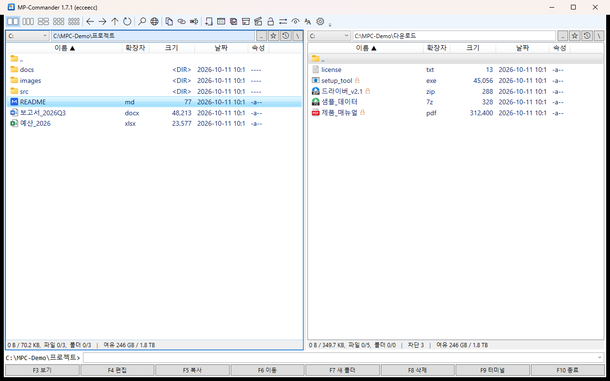

---

## 목차

- [시작하기](#시작하기)
- **1부 — 기능 설명**
  1. [화면 구성](#1-화면-구성)
  2. [패널 배치와 활성·대상 패널](#2-패널-배치와-활성대상-패널)
  3. [폴더 이동](#3-폴더-이동)
  4. [파일 선택](#4-파일-선택)
  5. [파일 작업 — 복사·이동·삭제·이름 바꾸기](#5-파일-작업--복사이동삭제이름-바꾸기)
  6. [보기 (F3)와 파일 안에서 찾기](#6-보기-f3와-파일-안에서-찾기)
  7. [파일 찾기 (Alt+F7)](#7-파일-찾기-altf7)
  8. [압축과 압축 풀기](#8-압축과-압축-풀기)
  9. [차단 해제 (인터넷에서 받은 파일)](#9-차단-해제-인터넷에서-받은-파일)
  10. [백업 후 복사 (Backup-Copy)](#10-백업-후-복사-backup-copy)
  11. [원격 연결 — FTP / FTPS / WebDAV](#11-원격-연결--ftp--ftps--webdav)
  12. [안드로이드폰 (USB)](#12-안드로이드폰-usb)
  13. [명령줄과 터미널](#13-명령줄과-터미널)
  14. [오른쪽 버튼 메뉴](#14-오른쪽-버튼-메뉴)
  15. [폴더 히스토리와 즐겨찾기 별](#15-폴더-히스토리와-즐겨찾기-별)
  16. [자동 새로고침과 네트워크 먹통 방지](#16-자동-새로고침과-네트워크-먹통-방지)
  17. [설정](#17-설정)
  18. [단축키 한눈에 보기](#18-단축키-한눈에-보기)
- **2부 — 목적별 활용**
  - [A. 프로그램 업데이트를 안전하게 배포하기 (백업·되돌리기)](#a-프로그램-업데이트를-안전하게-배포하기-백업되돌리기)
  - [B. 로그에서 오류 찾고 분석하기](#b-로그에서-오류-찾고-분석하기)
  - [C. 인터넷에서 받은 프로그램·자료 정리하기](#c-인터넷에서-받은-프로그램자료-정리하기)
  - [D. 자료를 보내거나 보관하려고 압축하기](#d-자료를-보내거나-보관하려고-압축하기)
  - [E. 휴대폰 사진·동영상 백업하기](#e-휴대폰-사진동영상-백업하기)
  - [F. NAS·웹 서버의 파일 관리하기](#f-nas웹-서버의-파일-관리하기)
  - [G. 여러 폴더를 한 화면에서 정리하기](#g-여러-폴더를-한-화면에서-정리하기)
  - [H. 느린 네트워크 공유 폴더에서 작업하기](#h-느린-네트워크-공유-폴더에서-작업하기)
- [문제 해결 (FAQ)](#문제-해결-faq)

---

## 시작하기

### 설치

설치 프로그램이 없습니다. 배포 압축 파일(`MP-Commander-1.7.x-win-x64.zip`)을 아무 폴더에 풀고 `MP-Commander.exe` 를 실행하면 됩니다.
폴더에는 세 파일만 있으면 됩니다 (약 0.4 MB).

| 파일 | 설명 |
|---|---|
| `MP-Commander.exe` | 프로그램 |
| `MP-Commander.exe.config` | .NET 실행 설정 |
| `FmCore.dll` | 빠른 파일 처리를 맡는 C++ 모듈 |

**실행 환경**: 64비트 Windows 10 1803 이후(LTSC 2019 포함) 또는 Windows 11. .NET Framework 4.7.2 가 기본으로 들어 있어 따로 설치할 것이 없습니다.

**7z 형식**을 쓰려면 [7-Zip](https://www.7-zip.org/) 이 설치돼 있거나, `7za.exe` 를 MP-Commander 폴더에 두면 됩니다. 없어도 ZIP 은 그대로 됩니다.

### 시작 경로 지정

```
MP-Commander.exe "C:\작업" "\\nas\공유" ftp://웹서버
```

주어진 경로를 패널 1, 2, 3 ... 에 엽니다. 바로 가기에 넣어 두면 늘 같은 폴더로 시작할 수 있습니다.

### 이 설명서 열기

**F1** 또는 툴바 맨 오른쪽 **?** 버튼. 프로그램 폴더의 `manual\MANUAL.md` 를 엽니다 —
같은 폴더에 `MDNotePad+.exe` 가 있으면 그것으로, 없으면 .md 에 연결된 프로그램으로(연결이 없으면 '연결 프로그램' 선택 창).

### 화면 언어 (한국어 / English)

처음에는 **Windows 의 표시 언어**를 따릅니다 (한국어 Windows 면 한국어, 그 밖에는 English).
설정(톱니바퀴) → **언어 / Language** 에서 바꾸고 프로그램을 다시 시작하면 적용됩니다.
언어 팩은 프로그램 폴더의 `lang\en.txt` 같은 텍스트 파일이라, 표현을 고치거나 새 언어를 더할 수 있습니다.

### 설정이 저장되는 곳

`%APPDATA%\MP-Commander\` — 창 위치·패널 경로·옵션(`settings.ini`), 폴더 히스토리(`MP-Commander.ini`), 원격 연결(`connections.ini`, 비밀번호는 암호화).
프로그램 폴더에는 아무것도 쓰지 않으므로, 프로그램 파일만 바꿔 끼우면 업데이트가 끝납니다.

---

# 1부 — 기능 설명

## 1. 화면 구성


| 위치 | 내용 |
|---|---|
| 맨 위 | **툴바** (아이콘에 마우스를 올리면 설명과 단축키) |
| 맨 위 오른쪽 | **검색 상자** — 입력하는 대로 Everything 으로 전체에서 찾아 펼치고, Enter 로 현재 패널에서 보기 ([7장](#7-파일-찾기-altf7)) |
| 패널 머리 | 드라이브 선택 · 경로 입력란 · `..`(상위) · ☆(즐겨찾기) · 🕘(히스토리) · `\`(루트) |
| 패널 목록 | 이름 · 확장자 · 크기 · 날짜 · 속성. 머리글을 누르면 정렬 |
| 패널 아래 | 선택한 크기/개수 · **차단 n**(인터넷에서 받은 파일 수) · 여유 공간 |
| 아래쪽 | **명령줄** (활성 패널 폴더에서 명령 실행) |
| 맨 아래 | F3~F10 기능 버튼 |

### 툴바


| 아이콘 (왼쪽부터) | 기능 | 단축키 |
|---|---|---|
| 격자 5개 | 2창 / 3창 / 4창(2×2) / 6창(2×3) / 8창(2×4) | Ctrl+F2 / F3 / F4 / F6 / F8 |
| ← → ↑ ⟳ | 뒤로 / 앞으로 / 상위 폴더 / 새로고침 | Alt+← / Alt+→ / Backspace / Ctrl+R |
| 돋보기 | 파일 찾기 | Alt+F7 |
| 지구본 | 원격 연결 관리 (FTP / WebDAV) | Ctrl+F |
| 문서 · 사슬 · 글자 | 현재 폴더 경로 / 선택 항목 전체 경로 / 이름 복사 | — / Ctrl+Shift+C / — |
| 폴더+ · `C:\` | 새 폴더 / 여기서 터미널 | F7 / F9 |
| 폴더+시계 | **백업 후 복사** | Ctrl+B |
| 상자 · 열린 상자 | **압축** / **압축 풀기** | Alt+F5 / Alt+F9 |
| 자물쇠 | **차단 해제** | Ctrl+Shift+U |
| ⇄ | 활성·대상 패널 경로 바꾸기 | Ctrl+U |
| 눈 | 숨김 파일 보기 | Ctrl+H |
| AA | 목록 글씨 크기 (작게·보통·크게) | Ctrl+= / Ctrl+- |
| 톱니바퀴 | **설정** | — |
| 문서+동기화 | **MDNotePad+ 동기화 모드** — 커서의 .md 파일을 저장소·동기화·git 이 있는 전체 모드로 (같은 폴더에 MDNotePad+.exe 가 있을 때만 보임) | — |
| ? | **사용 설명서** (이 문서) | F1 |

---

## 2. 패널 배치와 활성·대상 패널

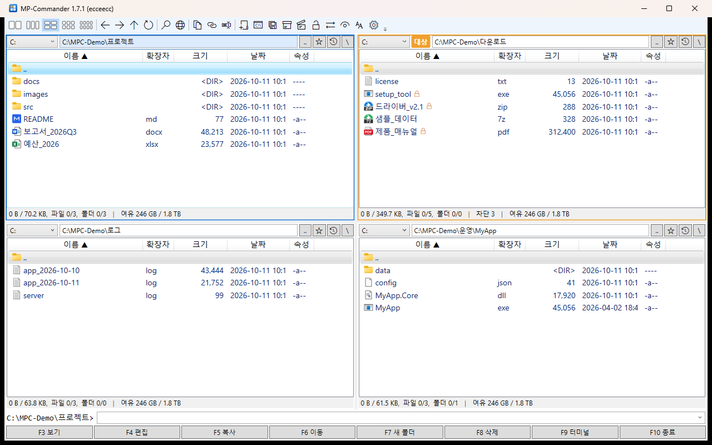

- **배치**: 2창·3창은 가로 한 줄, 4창은 2×2, 6창은 2×3, 8창은 2×4. 패널 번호는 위 줄 왼쪽부터 1, 2, 3 ... 입니다.
- **활성 패널** (파란 테두리): 지금 작업하는 패널. 키보드 명령은 모두 이 패널에 적용됩니다.
- **대상 패널** (주황 테두리와 `대상` 표시): 복사(F5)·이동(F6)·압축·압축 풀기·백업 후 복사의 **기본 목적지**.
  - 대상은 직전에 활성이던 패널이 됩니다. 2창에서는 늘 반대편입니다.
  - **Ctrl+Shift+숫자**로 대상을 고정할 수 있습니다 (예: 4창에서 늘 4번 패널로 보내기).
- 패널 이동: **Tab / Shift+Tab** 다음·이전 패널, **Ctrl+1~8** 해당 패널로.
- **Ctrl+← / Ctrl+→**: 커서의 폴더를 왼쪽/오른쪽 패널에서 엽니다.
- **Ctrl+U**: 활성 패널과 대상 패널의 경로를 맞바꿉니다.

마지막 배치·경로·정렬·창 크기는 끌 때 저장되고 다음 실행에 그대로 열립니다.

---

## 3. 폴더 이동

| 동작 | 방법 |
|---|---|
| 폴더 열기 / 파일 실행 | **Enter** 또는 더블클릭 |
| 상위 폴더 | **Backspace**, `..` 항목, 경로 옆 `..` 버튼, Ctrl+PgUp |
| 루트로 | **Ctrl+\\**, 경로 옆 `\` 버튼 (드라이브·공유·FTP·WebDAV·휴대폰의 맨 위) |
| 경로 직접 입력 | 경로 입력란(Ctrl+L)에 쓰고 Enter. `%TEMP%` 같은 환경 변수도 됩니다 |
| 드라이브 | 패널 왼쪽 위 목록, **Alt+F1 / Alt+F2** |
| 뒤로 / 앞으로 | **Alt+← / Alt+→**, 마우스의 뒤로·앞으로 버튼 (활성 패널에만 적용) |
| 빠른 검색 | 목록에서 글자를 입력하면 그 글자로 시작하는 항목으로 커서가 갑니다 (1.5초 안에 이어 입력) |

> **Backspace** 는 어디를 누른 상태든 늘 활성 패널의 상위 폴더로 갑니다. 빠른 검색을 입력하는 중이면 마지막 글자를 지웁니다.

---

## 4. 파일 선택

선택한 항목은 **빨간 글자**로 표시됩니다. 선택이 없으면 명령은 커서 항목 하나에 적용됩니다.

| 동작 | 방법 |
|---|---|
| 하나씩 선택/해제 | **Insert**, **Space**, **Ctrl+클릭** |
| 연속 선택 | **Shift+↑↓**, **Shift+클릭** |
| 마스크로 선택 / 해제 | **Num+** / **Num-** (예: `*.log`) |
| 반전 / 전체 | **Num*** / **Ctrl+A** |

> **Ctrl+클릭**은 Double Commander 와 같습니다 — 아직 선택한 것이 없을 때 다른 항목을 Ctrl+클릭하면 지금 커서 항목도 함께 선택됩니다.

> **폴더 크기 (Space)**: 폴더 위에서 **Space** 로 선택하면 하위 폴더까지 모든 파일의 크기 합을 백그라운드에서 계산해 크기 칸에 보여 줍니다
> (계산 중에는 `…` 와 함께 늘어나는 중간 합계). 계산하는 동안에도 다른 작업을 할 수 있고, 다른 폴더로 가면 멈춥니다.
> 끝나면 아래 상태 줄에 크기와 파일·폴더 수가 나오고, 선택 합계·전체 합계에도 들어갑니다. 휴대폰·FTP·WebDAV 폴더는 계산하지 않습니다.

---

## 5. 파일 작업 — 복사·이동·삭제·이름 바꾸기

| 작업 | 키 | 설명 |
|---|---|---|
| 복사 | **F5** | 대상 패널 폴더가 기본. 하나만 고르면 새 이름도 쓸 수 있습니다 |
| 이동 | **F6** | 같은 방식 |
| 이름 바꾸기 | **Shift+F6**, **F2** | |
| 새 폴더 | **F7** | |
| 삭제 | **F8**, **Del** (휴지통) / **Shift+F8**, **Shift+Del** (영구) | 휴대폰·FTP·WebDAV 는 휴지통이 없어 영구 삭제 |
| 클립보드 | **Ctrl+C / Ctrl+X / Ctrl+V** | 탐색기와 서로 주고받을 수 있습니다. 같은 폴더에 붙여넣으면 `이름 - 복사본` |
| 드래그 앤 드롭 | 다른 패널(또는 그 안의 폴더)에 놓기 | 메뉴에서 복사/이동. Ctrl 을 누른 채 놓으면 바로 복사, Shift 는 바로 이동 |
| 탐색기에서 가져오기 | 탐색기의 파일을 패널에 놓기, 또는 탐색기에서 복사(Ctrl+C) → 패널에서 Ctrl+V | **휴대폰(USB) 저장소, zip 안의 파일, Outlook 첨부**처럼 경로가 없는 항목도 PC 폴더로 복사됩니다 |

- 같은 이름이 있으면 **덮어쓰기 / 모두 덮어쓰기 / 더 새것만 / 건너뛰기 / 모두 건너뛰기 / 취소** 를 묻습니다.
- 진행 창에 파일별·전체 진행률과 속도가 나옵니다. 오래 걸리지 않는 작업은 진행 창 없이 끝납니다.
- 진행이 5초 넘게 멈추면(네트워크 지연 등) 경고가 나오고, [취소]는 막힌 I/O 까지 끊습니다.
  (덮어쓰기·오류 창에서 답을 기다리는 동안은 멈춤으로 치지 않습니다.)

---

## 6. 보기 (F3)와 파일 안에서 찾기

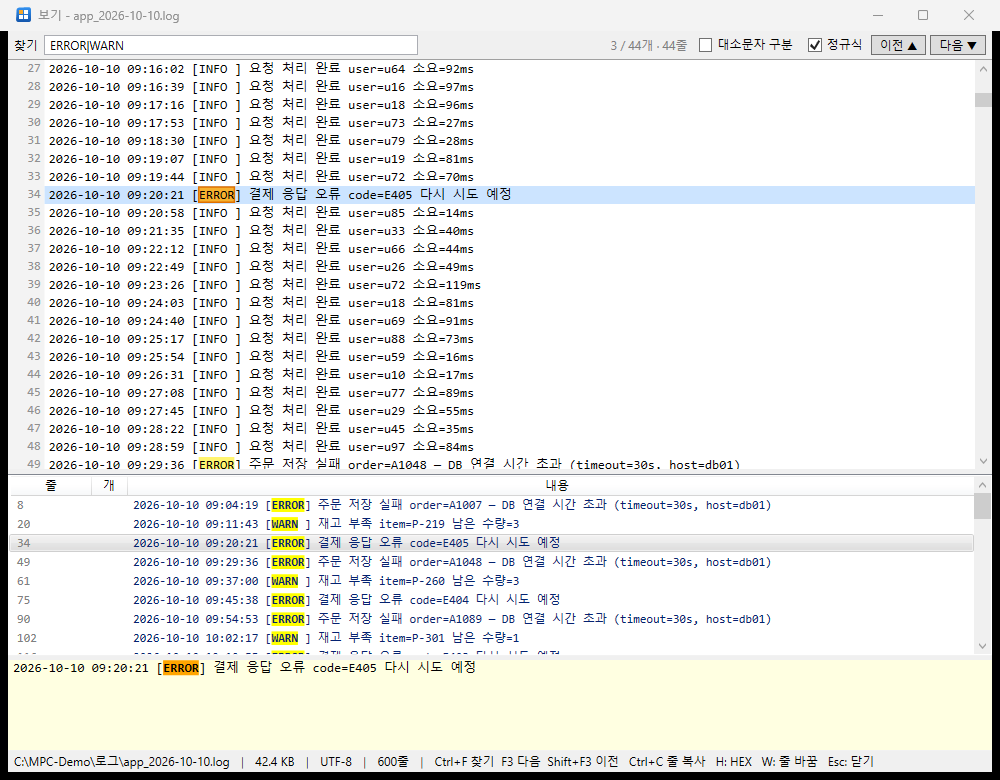

**F3**(또는 아래 `F3 보기` 버튼)으로 커서의 파일을 엽니다.

> **마크다운(.md)** 파일은 같은 폴더에 `MDNotePad+.exe` 가 있으면 MDNotePad+ 로 열립니다 (없으면 이 뷰어).

- **텍스트**: 인코딩 자동 판별 (UTF-8 / UTF-16 / 한글 ANSI). 왼쪽에 줄 번호.
- **아무리 큰 파일도 바로 열립니다** (300 MB 로그를 0.2초 안팎). 화면에 보이는 줄만 그때그때 읽어 그리고, 줄 위치 색인은 뒤에서 만듭니다
  (아래 상태 줄에 `색인 중 n%` → 끝나면 전체 줄 수). 스크롤 막대로 **파일 처음부터 끝까지** 바로 갈 수 있습니다 (Ctrl+Home / Ctrl+End).
- **글자 단위 선택과 복사**: 끌어서 / Shift+클릭으로 고르고 **Ctrl+C**. 더블클릭은 단어 선택(그 줄 전체는 아래 칸에), **Ctrl+A** 는 전체 선택.
  여러 줄·큰 범위도 뒤에서 읽어 복사합니다 (최대 64 MB).
- **16진수**: **H** 로 텍스트 ↔ HEX 전환 (앞 512 KB). 이진 파일은 자동으로 HEX.
- **이미지**: jpg, png, bmp, gif, tif, ico, webp.
- **W**: 긴 줄 자동 줄 바꿈 켜기/끄기. **Esc**(또는 찾을 말이 없을 때 F3)로 닫기.

### 파일 안에서 찾기

1. 위쪽 **찾기 칸**(Ctrl+F)에 찾을 말을 입력하고 **0.5초 멈추면** **파일 전체**에서 찾습니다 (Enter / F3 은 바로). 300 MB 를 1초 안팎, 정규식은 몇 초.
   찾는 동안에도 본문을 읽고 스크롤할 수 있고(스크롤하면 찾기가 화면을 옮기지 않음), 찾은 줄은 목록 끝에 계속 붙습니다 — 목록의 선택·스크롤은 그대로, 깜박이지 않습니다.
2. **F3** 다음, **Shift+F3** 이전 (Enter, `다음 ▼` / `이전 ▲` 버튼도 같음).
3. 본문에서 지금 찾은 말은 **주황 상자**로 표시되고, 그 줄로 스크롤됩니다.
4. 오른쪽 위에 `3 / 44개 · 44줄` 처럼 **현재 위치 / 찾은 개수 · 찾은 줄 수** (파일 전체 기준)가 나옵니다.
5. 아래 칸에 **찾은 줄이 모두** 줄 번호·개수와 함께 나오고, 찾은 말은 노란색으로 칠해집니다. 줄을 고르면 본문이 그 줄로 갑니다.
6. 그 아래 칸에는 **고른 줄 전체**가 자동 줄 바꿈으로 나옵니다 (긴 로그 한 줄도 끝까지 보입니다).
7. 칸 사이 경계선을 끌어 크기를 바꿀 수 있습니다.

옵션:

- **대소문자 구분**
- **정규식** — .NET 정규 표현식. `^` `$` 는 줄 단위로 맞습니다 (Windows 줄 끝 `\r\n` 도 됨). 식이 틀리면 오류를 보여 줍니다.

> 뷰어는 파일을 **읽자마자 닫습니다**. 열어 둔 동안에도 다른 프로그램이 그 파일에 계속 쓰거나, 이름을 바꾸거나, 지울 수 있습니다 (로그를 보면서 프로그램이 로그를 계속 써도 됩니다).

---

## 7. 파일 찾기 (Alt+F7)

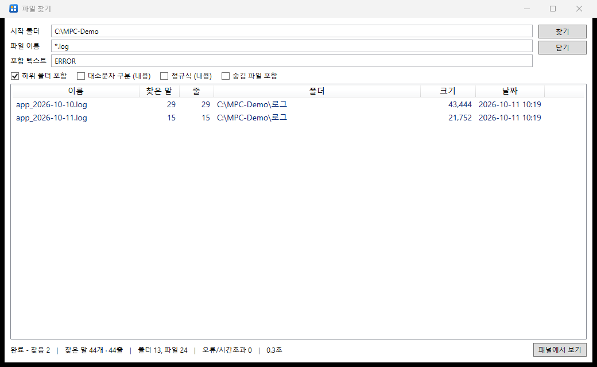

| 칸 | 설명 |
|---|---|
| 시작 폴더 | 기본은 활성 패널 폴더 |
| 파일 이름 | `*.txt;*.log` 처럼 `;` 로 여러 개. 와일드카드가 없으면 이름에 들어 있는 것을 찾습니다 |
| 포함 텍스트 | 파일 내용에서 찾을 말 (UTF-8 / 한글 ANSI / UTF-16 파일 모두) |
| 하위 폴더 포함 / 대소문자 구분 / **정규식** / 숨김 파일 포함 | 옵션 |

- 여러 스레드로 빠르게 찾고, 느린 네트워크에서는 한 번의 읽기가 5초를 넘으면 그 파일을 건너뛰고 계속합니다.
- 포함 텍스트로 찾으면 결과에 **찾은 말**(나온 횟수)과 **줄**(그 말이 있는 줄 수) 열이 나오고, 아래 상태 줄에 합계가 나옵니다.
  - 백그라운드에서 세며 세는 동안은 `…`, 64 MB 가 넘거나 읽지 못한 파일은 `-` 입니다.
- 결과에서 **Enter / 더블클릭**: 그 파일이 있는 폴더를 패널에서 열고 커서를 둡니다.
- 결과에서 **F3**: 뷰어로 열면서 **포함 텍스트로 이미 찾은 상태**(대소문자·정규식 설정 포함)로 엽니다. 바로 F3 으로 다음 일치로 넘어갈 수 있습니다.
- **Esc**: 찾는 중이면 멈추고, 아니면 창을 닫습니다.

### 툴바 검색 상자

툴바 오른쪽 끝의 검색 상자에 파일·폴더 이름을 입력하면, 입력이 0.3초 멈출 때 [Everything](https://www.voidtools.com/)(voidtools)이 **모든 드라이브에서** 찾아 상자 아래로 목록을 펼칩니다.

- **Enter** — 맨 위 항목을 **현재 패널**에서 보여 줍니다. 파일은 그 폴더를 열고 커서를 파일에, 폴더는 그 안으로 들어갑니다.
  (입력하자마자 Enter 를 눌러도 찾은 뒤에 이동합니다.)
- **↑ ↓ / PgUp PgDn** — 입력 칸에 커서를 둔 채 목록에서 고르기. 더블클릭도 됩니다. **Esc** 로 닫기 (한 번 더 누르면 입력을 지우고 패널로).
- 목록 순서: 이름이 똑같은 것 → 그 말로 시작하는 것 → 폴더 → 경로가 짧은 것 (최대 500개).
- Everything 문법을 그대로 씁니다: 공백 = 그리고, `|` = 또는, `*` `?`, `ext:pdf`, `folder:`, `size:>100mb` 등. 휴지통 안은 뺍니다.
- Everything 이 실행 중이 아니면 목록은 나오지 않고, **Enter 는 파일 찾기 창**(현재 패널 폴더, 그 이름으로 바로 찾기)을 엽니다.

> **Ctrl+Alt+F7 — Everything**: [Everything](https://www.voidtools.com/)(voidtools)이 설치되어 있으면 Everything 검색 창을 **현재 폴더 안에서 찾도록** 엽니다.
> 이름으로 드라이브 전체를 순식간에 찾을 때 편합니다. Everything 은 프로그램 폴더(휴대용), 실행 중인 Everything, 설치 정보, Program Files 순으로 찾습니다.

---

## 8. 압축과 압축 풀기

### 압축 (Alt+F5, 툴바 상자)

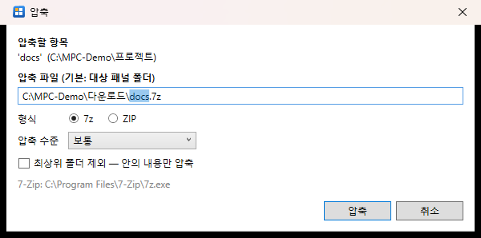

1. 압축할 파일·폴더를 고릅니다 (없으면 커서 항목).
2. 압축 파일은 기본으로 **대상 패널 폴더**에 만들어집니다. 경로·이름은 고칠 수 있습니다.
3. **형식**: **7z**(기본, 7-Zip 필요) 또는 **ZIP**(내장, 한글 이름이 어디서나 안 깨짐).
4. **압축 수준**: 저장(압축 안 함) / 빠르게 / 보통 / 최고.
5. 폴더 하나만 골랐다면 **최상위 폴더 제외 — 안의 내용만 압축** 을 켤 수 있습니다. 풀었을 때 폴더 없이 내용이 바로 나옵니다.

형식·수준·옵션은 기억합니다. 취소해도 반쯤 만든 압축 파일이 남지 않습니다.

### 압축 풀기 (Alt+F9, 툴바 열린 상자)

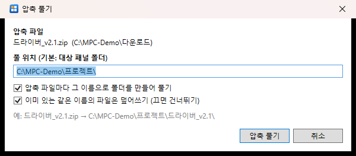

1. 압축 파일을 고릅니다 — **여러 개를 한 번에** 고를 수 있습니다.
2. 풀 위치는 기본으로 **대상 패널 폴더**.
3. **압축 파일마다 그 이름으로 폴더를 만들어 풀기** (기본 켬): `드라이버_v2.1.zip` → `드라이버_v2.1\`. 아래에 예시가 미리 나옵니다.
4. **같은 이름의 파일 덮어쓰기** (기본 켬, 끄면 건너뛰기).

지원 형식: ZIP(내장), 7z · RAR · TAR · GZ · BZ2 · XZ · CAB · ISO · WIM 등(7-Zip). `.tar.gz` · `.tgz` · `.tar.xz` 는 한 번에 끝까지 풉니다.

---

## 9. 차단 해제 (인터넷에서 받은 파일)

Windows 는 인터넷에서 받은 파일에 "다른 컴퓨터에서 왔음" 표시를 붙입니다. 이 표시가 있으면 실행할 때 보안 경고가 뜨거나, 문서가 '제한된 보기'로 열리거나, DLL·스크립트가 막힙니다.

- 목록에서 이런 파일은 이름 옆에 **주황 자물쇠**가 붙고, 패널 아래에 `차단 3` 처럼 개수가 나옵니다 (위 [기본 화면](#1-화면-구성) 오른쪽 패널).
- **Ctrl+Shift+U** 또는 툴바 자물쇠로 표시를 지웁니다.

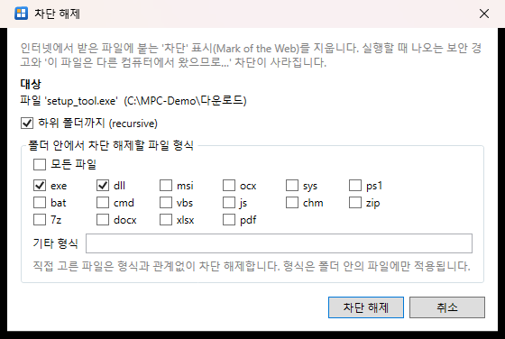

| 옵션 | 설명 |
|---|---|
| 대상 | 선택한 파일·폴더, 없으면 커서 항목, 그것도 없으면 현재 폴더 |
| 하위 폴더까지 | 기본 켬 |
| 파일 형식 | 폴더 안에서 처리할 형식 (기본 exe, dll). **모든 파일** 도 가능 |

직접 고른 파일은 형식과 상관없이 처리합니다. 읽기 전용 파일도 처리하며 속성은 그대로 둡니다. 탐색기의 파일 속성 → '차단 해제', PowerShell `Unblock-File` 과 같은 동작입니다.

---

## 10. 백업 후 복사 (Backup-Copy)

프로그램 업데이트처럼 **대상 폴더의 옛 파일을 먼저 백업해 두고 새 파일로 바꿀 때** 씁니다.
툴바 폴더+시계 아이콘, **Ctrl+B**, 오른쪽 버튼 메뉴 `백업 후 복사`.

### ① 준비 창

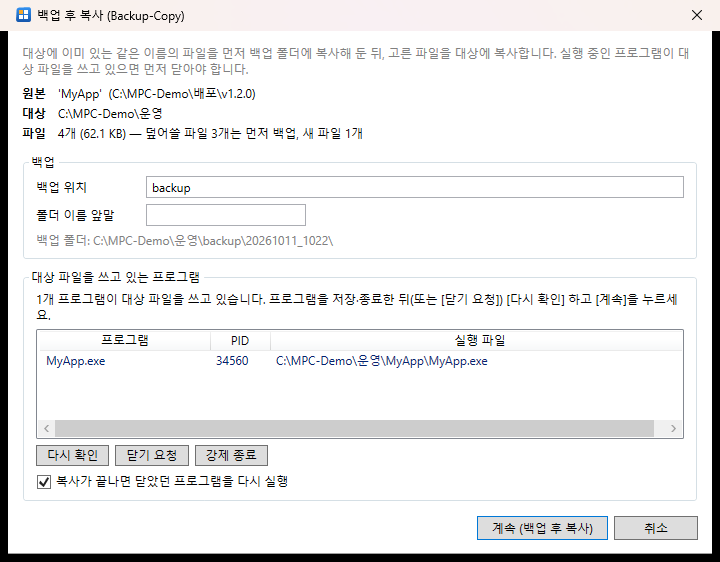

- **원본 / 대상 / 파일**: 복사할 파일 수와 그중 **덮어쓸 파일**(먼저 백업됨)·**새 파일** 수.
- **백업 위치**: 기본 `backup` (상대 경로면 대상 폴더 아래). `D:\백업\MyApp` 처럼 절대 경로도 됩니다.
- **폴더 이름 앞말**: 선택. 예: `v1.1.3_` → `backup\v1.1.3_20261011_1022\`. 백업 폴더 경로가 미리 나옵니다.
- **대상 파일을 쓰고 있는 프로그램**: 덮어쓸 파일을 실행·사용 중인 프로그램을 찾아 보여 줍니다 (실행 중인 exe, 불러온 DLL, 열려 있는 파일까지).
  - **닫기 요청**: 그 프로그램에 창 닫기를 요청합니다 (저장할지 묻는 창이 뜨면 그 프로그램에서 답하세요).
  - **강제 종료**: 저장하지 않은 내용은 사라집니다. 확인 후 끝냅니다.
  - **다시 확인**: 직접 닫은 뒤 다시 검사.
- **복사가 끝나면 닫았던 프로그램을 다시 실행** (기본 켬): 같은 실행 파일·같은 인자로 다시 띄웁니다.

### ② 백업 → 복사

[계속]을 누르면 진행 창이 뜨고,

1. 덮어쓸 파일을 백업 폴더에 **같은 폴더 구조로** 먼저 복사합니다. 백업에 실패한 파일은 덮어쓰지 않습니다.
2. 새 파일을 대상에 복사합니다.

복사하려는 파일을 아직 다른 프로그램이 쓰고 있으면 이 창이 뜹니다.

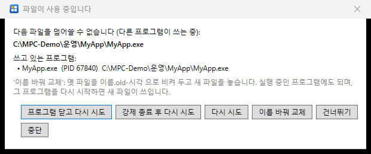

| 버튼 | 동작 |
|---|---|
| 프로그램 닫고 다시 시도 | 쓰고 있는 프로그램에 닫기를 요청한 뒤 다시 복사 |
| 강제 종료 후 다시 시도 | 강제로 끝낸 뒤 다시 복사 |
| 다시 시도 | 직접 닫은 뒤 다시 복사 |
| **이름 바꿔 교체** | 옛 파일을 `이름.old-시각` 으로 비켜 두고 새 파일을 놓습니다. **실행 중인 exe·dll 도 됩니다** — 그 프로그램을 다시 시작하면 새 파일이 쓰입니다 |
| 건너뛰기 / 중단 | 이 파일만 건너뛰기 / 작업 중단 |

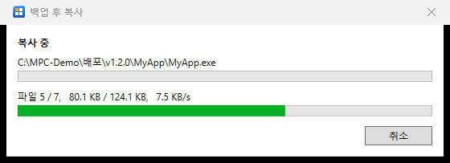

### ③ 끝난 뒤

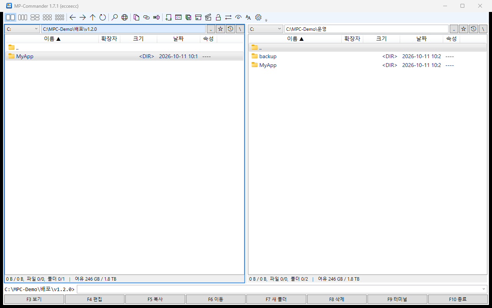

- 대상 폴더(또는 지정한 위치)에 `backup\20261011_1022\` 가 생기고, 그 안에 옛 파일과 **`backup-copy.log`**(무엇을 백업·복사·닫았는지, 실패한 것)가 남습니다.
- 닫았던 프로그램을 다시 실행하고, 상태 줄에 `복사 n개, 백업 m개, 다시 실행 k개 │ 백업: 경로` 가 나옵니다.

> 되돌리는 방법은 2부 [A. 프로그램 업데이트를 안전하게 배포하기](#a-프로그램-업데이트를-안전하게-배포하기-백업되돌리기) 를 보세요.

---

## 11. 원격 연결 — FTP / FTPS / WebDAV

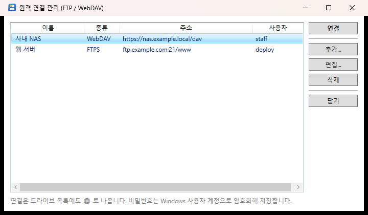

**Ctrl+F** 또는 툴바 지구본으로 연결을 관리합니다 (추가 / 편집 / 삭제 / 연결).

- 종류: **FTP**, **FTPS**(명시적 TLS), **WebDAV**(http/https). SFTP(SSH)는 지원하지 않습니다.
- 등록한 연결은 드라이브 목록에도 🌐 로 나옵니다. 경로는 `ftp://연결이름/폴더`, `dav://연결이름/폴더`.
- 목록 보기, 복사·이동(F5/F6, 드래그 앤 드롭) — PC↔원격, 원격↔원격(예: FTP → WebDAV), 새 폴더, 이름 바꾸기, 삭제(영구), F3/F4/Enter(임시 사본으로 열기).
- WebDAV 는 서버가 알려 주면 실제 여유 공간을 보여 줍니다.
- 비밀번호는 Windows 사용자 계정으로 **암호화**해 저장합니다 (다른 계정·PC 에서는 풀 수 없음).
- 자체 서명 인증서를 쓰는 NAS 는 연결 설정에서 "인증서 오류 무시"를 켭니다.
- 서버가 응답하지 않으면 5초 안에 끊고 오류를 보여 줍니다 (프로그램이 멈추지 않습니다).

---

## 12. 안드로이드폰 (USB)

1. 폰을 USB 로 연결하고 잠금을 풉니다.
2. 폰의 USB 알림에서 **파일 전송**을 고릅니다.
3. 드라이브 목록 끝의 `📱 기기 이름` 을 고릅니다. 경로는 `mtp://기기이름/저장소/폴더`.

- 폰↔PC 복사·이동, 새 폴더, 이름 바꾸기, 삭제(영구), 여유 공간 보기.
- F3/F4/Enter 는 PC 임시 폴더로 받아서 엽니다 (F4 로 고친 내용이 폰에 자동으로 올라가지는 않음).
- 파일 찾기·터미널·자동 새로고침은 폰에서 쓸 수 없습니다.

---

## 13. 명령줄과 터미널

- 아래쪽 **명령줄**(Ctrl+E): 프롬프트에 활성 패널 폴더가 나오고, 그 폴더에서 명령을 실행합니다.
  - Enter: 프로그램은 바로 실행, 문서는 연결 프로그램으로, `dir`·`copy` 같은 내부 명령과 배치 파일은 cmd 창에서.
  - Shift+Enter: 늘 cmd 창에서 실행하고 창을 남깁니다.
  - `cd 경로`, `cd..`, `D:` 는 실행하지 않고 **패널을 이동**합니다.
  - ↑↓ 이전 명령 (최근 50개).
  - Ctrl+Enter / Ctrl+Shift+Enter / Ctrl+P: 커서 파일 이름 / 전체 경로 / 현재 폴더 경로를 명령줄에 넣기.
- **F9**: 현재 폴더에서 터미널 열기 (Windows Terminal 이 있으면 그것, 없으면 cmd).

---

## 14. 오른쪽 버튼 메뉴

- 위쪽: MP-Commander 명령 — 보기, 편집, 대상 패널로 복사/이동, **백업 후 복사**, 이름 바꾸기, 경로·이름 복사, 압축, 압축 풀기, 차단 해제.
- 아래쪽: **탐색기와 똑같은 셸 메뉴** — 7-Zip·반디집, 보내기, 연결 프로그램, 속성, Git 등 설치된 확장이 그대로 나옵니다. Shift 를 누른 채 열면 확장 메뉴도 보입니다.
- 빈 곳을 누르면 폴더 메뉴 (붙여넣기, 새 폴더, 새로고침, 경로 복사, 터미널, 이 폴더 차단 해제 ...).
- 네트워크 서버가 응답하지 않으면 셸 메뉴는 빼고 보여 줍니다 (셸 확장 때문에 멈추는 것을 막음).

---

## 15. 폴더 히스토리와 즐겨찾기 별

- **Alt+↓** 또는 경로 옆 🕘 버튼: 폴더 히스토리 메뉴.
  - 맨 위: **자주 머문 폴더** — 머문 시간과 방문 횟수로 순위를 매긴 5개 (오래 안 가면 점점 내려갑니다).
  - 그 아래: 최근 폴더 (모든 패널 공용).
- **☆ 버튼 (Ctrl+D)**: 현재 폴더를 자주 머문 폴더 맨 위에 **고정**합니다. 목록에 있는 폴더면 노란 ★ 로 켜지고, 다시 누르면 내립니다.

---

## 16. 자동 새로고침과 네트워크 먹통 방지

폴더 안의 파일이 추가·삭제·이름 변경되면 목록이 저절로 바뀝니다 (커서와 선택은 유지).

| 위치 | 반영까지 |
|---|---|
| 로컬 드라이브, USB | 1초 이내 |
| 네트워크 공유 (`\\서버\공유`) | 약 2~5초 |
| WebDAV·FTP 연결, 휴대폰 | 최대 8초 |

느린·끊긴 네트워크에서도 프로그램이 멈추지 않도록:

- 네트워크 경로는 접근 전에 서버에 2초 안에 닿는지 먼저 확인합니다.
- 폴더 읽기가 5초 동안 진행이 없으면 끊고, 노란 오류 줄에 [다시 시도] 를 보여 줍니다 (이전 목록은 그대로).
- 복사가 멈추면 진행 창에 경고가 나오고 [취소]로 막힌 작업까지 끊습니다.

---

## 17. 설정

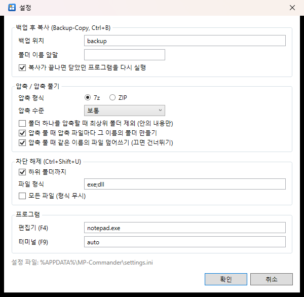

툴바 톱니바퀴로 엽니다.

| 묶음 | 항목 |
|---|---|
| 백업 후 복사 | 백업 위치, 폴더 이름 앞말, 끝나면 다시 실행 |
| 압축 / 압축 풀기 | 기본 형식·수준, 최상위 폴더 제외, 압축 파일마다 폴더 만들기, 덮어쓰기 |
| 차단 해제 | 하위 폴더까지, 파일 형식, 모든 파일 |
| 프로그램 | F4 편집기 (기본 메모장), F9 터미널 (`auto` = Windows Terminal 우선) |
| 언어 / Language | 화면 언어 — 자동(운영체제 언어), 한국어, English. 다시 시작하면 적용 |

그 밖에 숨김 파일 보기(Ctrl+H), 글씨 크기(Ctrl+= / Ctrl+-)는 툴바에서 바로 바꾸고 저장됩니다.

---

## 18. 단축키 한눈에 보기

| 분류 | 키 | 동작 |
|---|---|---|
| 파일 | F3 / F4 | 보기 / 편집 |
| | F5 / F6 | 복사 / 이동 (대상 패널로) |
| | Shift+F6, F2 | 이름 바꾸기 |
| | F7 | 새 폴더 |
| | F8, Del / Shift+F8, Shift+Del | 휴지통으로 삭제 / 영구 삭제 |
| | Ctrl+C / Ctrl+X / Ctrl+V | 클립보드 복사 / 잘라내기 / 붙여넣기 |
| | Ctrl+B | 백업 후 복사 |
| | Alt+F5 / Alt+F9 | 압축 / 압축 풀기 |
| | Ctrl+Shift+U | 차단 해제 |
| | Alt+F7 | 파일 찾기 |
| | Ctrl+Alt+F7 | Everything 검색 창 (현재 폴더) |
| 이동 | Enter / Backspace | 열기 / 상위 폴더 |
| | Ctrl+\\ | 루트 |
| | Alt+← / Alt+→ | 뒤로 / 앞으로 |
| | Alt+↓ | 폴더 히스토리 |
| | Ctrl+D | 즐겨찾기 별 |
| | Alt+F1 / Alt+F2 | 드라이브 선택 |
| | Ctrl+L | 경로 입력란 |
| 패널 | Tab / Shift+Tab | 다음 / 이전 패널 |
| | Ctrl+1~8 / Ctrl+Shift+1~8 | 패널로 이동 / 대상 패널로 고정 |
| | Ctrl+← / Ctrl+→ | 커서의 폴더를 옆 패널에서 열기 |
| | Ctrl+U | 활성·대상 경로 바꾸기 |
| | Ctrl+F2 / F3 / F4 / F6 / F8 | 2 / 3 / 4 / 6 / 8창 |
| 선택 | Insert, Space, Ctrl+클릭 | 하나씩 (Space 는 폴더면 크기 계산) |
| | Shift+↑↓, Shift+클릭 | 연속 |
| | Num+ / Num- / Num* / Ctrl+A | 마스크 선택 / 해제 / 반전 / 전체 |
| 기타 | F1 | 사용 설명서 |
| | Ctrl+R / Ctrl+H | 새로고침 / 숨김 파일 |
| | Ctrl+= / Ctrl+- | 글씨 크게 / 작게 |
| | Ctrl+Shift+C | 선택 항목 전체 경로 복사 |
| | Ctrl+E / F9 | 명령줄 / 터미널 |
| | Ctrl+F | 원격 연결 관리 |
| | 오른쪽 버튼, Shift+F10, 메뉴 키 | 오른쪽 버튼 메뉴 |
| | F10 | 종료 |
| 뷰어 | Ctrl+F / F3 / Shift+F3 | 찾기 / 다음 / 이전 |
| | Ctrl+Home / Ctrl+End, PgUp / PgDn | 파일 처음 / 끝, 한 화면씩 |
| | 끌기 · Shift+클릭 · Ctrl+A, Ctrl+C | 글자 단위 선택, 복사 |
| | 더블클릭 | 단어 선택 + 그 줄 전체를 아래 칸에 |
| | H / W / Esc | HEX / 줄 바꿈 / 닫기 |

---

# 2부 — 목적별 활용

## A. 프로그램 업데이트를 안전하게 배포하기 (백업·되돌리기)

**상황**: 운영 PC 의 `C:\운영\MyApp` 을 새 버전 `\\빌드서버\배포\v1.2.0\MyApp` 으로 바꾸고 싶다. 프로그램이 실행 중이고, 문제가 생기면 바로 이전 버전으로 돌아가야 한다.

**준비**

1. 왼쪽(활성) 패널: 새 버전이 있는 폴더 — `...\v1.2.0` (그 안에 `MyApp` 폴더).
2. 오른쪽(대상) 패널: 운영 폴더의 **상위** — `C:\운영` (그 안에 `MyApp` 폴더).
   - 폴더째 고르면 `MyApp\*` 이 `C:\운영\MyApp\` 위에 덮어써집니다.
   - 폴더 안의 파일만 고르고 싶으면 양쪽 모두 `MyApp` 안으로 들어가서 파일들을 고르면 됩니다.

**배포**

3. 왼쪽에서 `MyApp` 에 커서를 두고 **Ctrl+B**.
4. 준비 창에서 확인합니다 ([10장 그림](#10-백업-후-복사-backup-copy)).
   - "덮어쓸 파일 n개는 먼저 백업" — 바뀔 파일 수가 맞는지.
   - **폴더 이름 앞말**에 지금 버전을 적어 두면 나중에 찾기 쉽습니다. 예: `v1.1.3_` → `backup\v1.1.3_20261011_1022\`
   - 실행 중인 프로그램이 보이면 **닫기 요청** (또는 그 프로그램에서 직접 저장·종료 후 **다시 확인**).
   - **복사가 끝나면 닫았던 프로그램을 다시 실행** 이 켜져 있는지.
5. **계속** → 백업 → 복사 → 프로그램 다시 실행.
6. 상태 줄과 `backup\...\backup-copy.log` 로 결과를 확인합니다.

**문제가 생겨 되돌릴 때 (롤백)**

1. 대상 패널을 `C:\운영` 그대로 두고, 활성 패널을 `C:\운영\backup\v1.1.3_20261011_1022` 로 엽니다 (그 안에 `MyApp` 폴더 — 옛 파일들).
2. `MyApp` 에 커서를 두고 다시 **Ctrl+B**.
3. 이번에는 지금(문제 있는) 버전이 새 백업 폴더로 저장되고, 옛 파일이 제자리로 돌아갑니다. 프로그램도 다시 실행됩니다.

> 백업에는 **바뀐 파일만** 들어갑니다(새로 생긴 파일은 백업할 것이 없음). 새 버전에서 추가된 파일까지 지우려면 `backup-copy.log` 의 `복사` 줄 중 백업에 없는 파일을 지우면 됩니다.

**팁**

- 백업을 대상 폴더 밖에 모으려면 백업 위치를 절대 경로로 (예: `D:\배포백업\MyApp`). 설정 창에서 기본값으로 바꿔 둘 수 있습니다.
- **서비스**로 도는 프로그램은 닫기·다시 실행 대상에서 빠집니다. 서비스는 먼저 직접 멈추세요.
- **MP-Commander 자신**을 업데이트할 때: 사용 중 창에서 **이름 바꿔 교체** 를 고르면 지금 실행 중인 채로 새 파일로 바뀌고, 다시 시작하면 새 버전이 실행됩니다.
- 다른 PC 에서 공유 폴더로 열어 둔 파일은 이 PC 에서 찾을 수 없습니다 — 사용 중 창의 '다시 시도' 로 해결하거나 그 PC 에서 닫으세요.

---

## B. 로그에서 오류 찾고 분석하기

**상황**: 여러 날짜의 로그 파일 중 오류가 난 파일과 횟수를 알고, 오류 줄만 모아 보고 싶다.

1. 로그 폴더에서 **Alt+F7** → 파일 이름 `*.log`, 포함 텍스트 `ERROR` → 찾기.
2. 결과의 **찾은 말 / 줄** 열로 어느 파일에 오류가 몇 번 있는지 한눈에 봅니다 ([7장 그림](#7-파일-찾기-altf7)). 아래 합계도 확인.
3. 오류가 많은 파일에 커서를 두고 **F3** — 뷰어가 `ERROR` 로 이미 찾은 상태로 열립니다.
4. 아래 **찾은 줄 목록**에서 줄을 하나씩 고르며, 그 아래 칸에서 긴 줄 전체를 읽습니다. F3 / Shift+F3 로 다음·이전.
5. 경고까지 함께 보려면 **정규식** 을 켜고 `ERROR|WARN` ([6장 그림](#6-보기-f3와-파일-안에서-찾기)).

**자주 쓰는 정규식**

| 목적 | 식 |
|---|---|
| 오류 또는 경고 | `ERROR\|WARN` |
| 특정 시간대 (09시 대) | `^2026-10-10 09:` |
| 오류 코드 | `code=E\d+` |
| 주문 번호 A로 시작하는 오류 | `ERROR.*order=A\d+` |
| 느린 요청 (1초 이상) | `소요=\d{4,}ms` |
| 줄 끝이 특정 말로 끝남 | `실패$` |
| 빈 줄 아닌 주석 줄 | `^\s*#` |

> 로그를 쓰는 프로그램이 실행 중이어도 괜찮습니다. 뷰어와 파일 찾기는 파일을 잠그지 않습니다.
> 수백 MB ~ GB 로그도 뷰어가 바로 열리고 파일 전체를 찾습니다 (300 MB: 열기 0.2초, 찾기 1초 안팎, 정규식 약 1~2초). 찾는 동안에도 목록을 보며 줄을 고를 수 있습니다.

---

## C. 인터넷에서 받은 프로그램·자료 정리하기

**상황**: 받은 압축 파일들을 풀고, 실행할 때 보안 경고가 안 나오게 하고 싶다.

1. 다운로드 폴더를 엽니다. 받은 파일에는 **주황 자물쇠**가 붙고, 패널 아래에 `차단 n` 이 나옵니다.
2. 대상 패널을 풀 곳(예: `D:\도구`)으로 엽니다.
3. 압축 파일들을 선택(Insert / Ctrl+클릭)하고 **Alt+F9** → **압축 파일마다 폴더 만들기** 켠 채로 풀기.
   - `도구A.zip`, `도구B.7z` → `D:\도구\도구A\`, `D:\도구\도구B\`
4. 대상 패널(`D:\도구`)로 가서 **Ctrl+Shift+U** → **하위 폴더까지**, 형식 `exe; dll; ps1; bat` 등 → 차단 해제.
   - 압축 안의 파일도 차단 표시를 물려받는 경우가 많아 풀고 나서 하는 것이 좋습니다.
   - 문서(docx, xlsx, pdf)가 '제한된 보기'로 열리면 그 형식도 체크하거나 **모든 파일**.

---

## D. 자료를 보내거나 보관하려고 압축하기

| 목적 | 추천 |
|---|---|
| 상대가 압축 프로그램이 없을 수도 있음 (메일 첨부 등) | **ZIP** — Windows 기본으로 열림, 한글 이름 안 깨짐 |
| 용량을 최대한 줄여 보관 | **7z**, 수준 **최고** |
| 이미 압축된 사진·동영상 묶기 | **저장(압축 안 함)** — 빠르고 크기 차이가 거의 없음 |
| 풀었을 때 폴더 없이 내용만 나오게 | 폴더 하나 고르고 **최상위 폴더 제외** |

1. 보낼 파일·폴더를 고르고, 대상 패널을 압축 파일을 둘 곳으로.
2. **Alt+F5** → 이름·형식·수준 → 압축.
3. 다 되면 대상 패널에서 커서가 새 압축 파일에 가 있습니다. 오른쪽 버튼 메뉴의 '보내기' 등으로 바로 전달할 수 있습니다.

---

## E. 휴대폰 사진·동영상 백업하기

1. 폰을 USB 로 연결하고 **파일 전송** 모드로.
2. 왼쪽 패널: 드라이브 목록의 `📱 폰이름` → `내장 저장공간\DCIM\Camera`.
3. 오른쪽 패널: PC 백업 폴더 (예: `D:\사진\2026`).
4. 옮길 사진을 고릅니다 — 날짜순 정렬(날짜 머리글) 후 Shift+↓ 로 범위 선택, 또는 **Num+** 에 `*.jpg` / `*.mp4`.
5. **F5** (폰에 남김) 또는 **F6** (폰에서 지움). 같은 이름은 '건너뛰기' / '모두 건너뛰기' 로 이미 받은 것을 건너뜁니다.

> 폰 작업은 10초 동안 진행이 없으면 끊고 다음에 다시 연결합니다. 케이블이 빠져도 프로그램이 멈추지 않습니다.

---

## F. NAS·웹 서버의 파일 관리하기

1. **Ctrl+F** → **추가** → 이름(예: `사내 NAS`), 종류(WebDAV / FTP / FTPS), 주소, 사용자, 비밀번호 → 저장 ([11장 그림](#11-원격-연결--ftp--ftps--webdav)).
2. **연결** 또는 드라이브 목록의 🌐 항목으로 엽니다.
3. 한쪽은 PC, 한쪽은 서버로 두고 F5 / F6 / 드래그 앤 드롭.
   - 웹 사이트 배포: PC 의 빌드 결과 폴더 → FTP 의 `/www`.
   - NAS ↔ 웹 서버처럼 **원격끼리**도 바로 복사할 수 있습니다 (PC 임시 파일을 거침).
4. 서버의 파일을 F3 / F4 로 열면 임시 사본으로 엽니다.

> 원격에는 휴지통이 없습니다. 삭제는 영구 삭제입니다.

---

## G. 여러 폴더를 한 화면에서 정리하기

**상황**: 받은 자료를 여러 프로젝트 폴더로 나눠 옮긴다.

1. **Ctrl+F4**(4창) 또는 **Ctrl+F6 / Ctrl+F8**(6·8창).
2. 1번 패널에 정리할 폴더, 나머지 패널에 각 목적지 폴더 ([2장 그림](#2-패널-배치와-활성대상-패널)).
3. 파일을 골라 원하는 패널로 **끌어다 놓기** (Ctrl 누르면 복사, Shift 누르면 이동).
4. 한 곳으로 계속 보낼 때는 **Ctrl+Shift+숫자**로 그 패널을 대상으로 고정하고 F5 / F6 만 누릅니다.
5. 자주 쓰는 목적지는 **☆ (Ctrl+D)** 로 고정해 두면 **Alt+↓** 메뉴 맨 위에서 바로 엽니다.

---

## H. 느린 네트워크 공유 폴더에서 작업하기

- 서버가 꺼져 있거나 VPN 이 끊겨도 2초 안에 "연결할 수 없음" 이 나옵니다. 프로그램 전체가 멈추지 않습니다.
- 폴더가 너무 오래 걸리면 노란 오류 줄의 [다시 시도] 로 다시 읽습니다. 이전 목록은 남아 있습니다.
- 큰 파일 복사 중 네트워크가 멈추면 진행 창에 경고가 나오고, [취소]가 막힌 작업까지 끊습니다.
- 공유 폴더도 다른 사람이 바꾼 파일이 몇 초 안에 목록에 반영됩니다.
- 공유 폴더에서 파일 찾기를 할 때는 범위를 좁히고(파일 이름 마스크), 응답 없는 파일은 5초 뒤 건너뛰고 계속 찾습니다.

---

## 문제 해결 (FAQ)

**Q. 7z 를 고를 수 없습니다.**
7-Zip 이 설치되지 않은 PC 입니다. [7-Zip](https://www.7-zip.org/) 을 설치하거나 `7za.exe` 를 MP-Commander 폴더에 두세요. ZIP 은 그대로 됩니다.

**Q. 백업 후 복사에서 "쓰고 있는 프로그램을 찾지 못했습니다" 라는데 복사가 안 됩니다.**
다른 PC 가 네트워크로 그 파일을 열고 있거나, 권한 문제일 수 있습니다. 그 PC 에서 파일을 닫고 '다시 시도' 하거나, 실행 파일이면 '이름 바꿔 교체' 를 쓰세요.

**Q. 강제 종료가 안 됩니다.**
관리자 권한으로 실행된 프로그램은 일반 권한의 MP-Commander 가 끝낼 수 없습니다. 그 프로그램에서 직접 종료하세요.

**Q. 차단 해제했는데도 문서가 '제한된 보기' 로 열립니다.**
차단 해제 창의 파일 형식에 그 문서 형식(docx, xlsx, pdf ...)이 들어 있는지, 또는 **모든 파일** 을 켰는지 확인하세요.

**Q. 정규식이 맞는데 아무것도 안 찾아집니다.**
`$` 는 줄 끝을 뜻합니다. 대소문자 구분이 켜져 있는지, 특수 문자(`.` `(` `[` `|` 등)를 글자 그대로 찾으려면 앞에 `\` 를 붙였는지 확인하세요. 식이 틀리면 찾기 칸 오른쪽(또는 파일 찾기의 상태 줄)에 오류가 나옵니다.

**Q. 파일 찾기의 찾은 말 칸이 `-` 입니다.**
64 MB 보다 큰 파일이거나, 5초 안에 읽지 못한 파일(느린 네트워크)입니다. 그 파일을 F3 으로 열면 뷰어가 파일 전체에서 찾아 개수와 줄을 모두 보여 줍니다.

**Q. 휴대폰이 드라이브 목록에 없습니다.**
폰 잠금을 풀고, USB 알림에서 '충전만' 이 아닌 **파일 전송** 을 고르세요. 그 뒤 드라이브 목록을 다시 여세요.

**Q. 설정을 처음 상태로 돌리고 싶습니다.**
MP-Commander 를 끄고 `%APPDATA%\MP-Commander\settings.ini` 를 지우세요. 원격 연결(`connections.ini`)과 히스토리(`MP-Commander.ini`)는 따로 남습니다.
